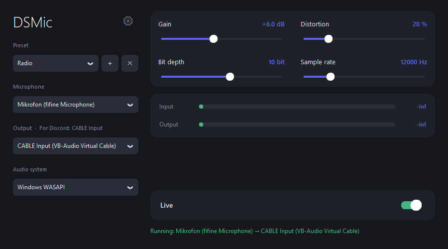

# DSMic

[English](README.md) · **Deutsch**

Eine kleine Windows-App, die dein Mikrofon live bearbeitet (Verstärkung, Verzerrung, Lo-Fi-„Qualität“) und das Ergebnis an ein virtuelles Audiokabel sendet. So hören die Leute auf **Discord** (oder in jeder anderen App) deine bearbeitete Stimme.



## Funktionen

- **Verstärkung**: -20 bis +40 dB
- **Verzerrung**: 0–100 % Soft-Clip-Overdrive
- **Qualität**: Reduzierung von Bittiefe (2–16 Bit) und Abtastrate (2 000–48 000 Hz) für Radio-, Telefon- oder Retro-Klang
- **Voreinstellungen**: eingebaute (Normal, Laut, Radio, Telefon, Roboter, Megafon, Retro 8-Bit, Chaos) und eigene
- **Pegelanzeigen** für Ein- und Ausgang, auch schon bevor Audio weitergeleitet wird
- **Immer live**: Das Audio startet, sobald die App geöffnet wird; ein **Live**-Schalter pausiert es
- **Mit Windows starten**, auf Wunsch minimiert
- **Sprachen**: Deutsch, English, Magyar
- **Installer**, der das virtuelle Audiokabel VB-CABLE für dich herunterladen und installieren kann

## So funktioniert es

```
Mikrofon ──► DSMic (Verstärkung → Verzerrung → Bittiefe/Abtastrate) ──► CABLE Input
                                                                            │
                                         Discord-Eingabegerät ◄── CABLE Output
```

DSMic erzeugt selbst kein virtuelles Gerät, sondern schreibt in eins. [VB-CABLE](https://vb-audio.com/Cable/) stellt dieses Gerät bereit.

## Installation

### Variante A: Installer (empfohlen)

1. Starte `DSMic_Setup.exe` (Administratorrechte sind nötig).
2. Lass **„VB-CABLE virtuelles Audiokabel herunterladen und installieren“** angehakt, falls du es noch nicht hast. Der Installer lädt es von der offiziellen Seite vb-audio.com herunter. Die Option wird ausgeblendet, wenn VB-CABLE bereits installiert ist.
3. Windows fragt eventuell nach einer Bestätigung für den VB-Audio-Treiber. Starte Windows neu, falls das Kabel nicht erscheint.

### Variante B: aus dem Quellcode starten

Benötigt Windows und Python 3.10+.

```bash
pip install sounddevice numpy customtkinter
python main.py
```

VB-CABLE musst du dann selbst von <https://vb-audio.com/Cable/> installieren.

## Verwendung mit Discord

1. Wähle in DSMic dein Mikrofon und stelle den **Ausgang** auf **CABLE Input (VB-Audio Virtual Cable)**. Das wird automatisch gewählt, wenn es verfügbar ist.
2. Öffne in Discord *Benutzereinstellungen → Sprache & Video* und setze das **Eingabegerät** auf **CABLE Output (VB-Audio Virtual Cable)**.
3. Schalte in Discord die **automatische Eingabeempfindlichkeit** und die Rauschunterdrückung aus, falls sie deinen Effekt beeinflussen (sie können Verzerrung herausfiltern).
4. Sprich und beobachte die Pegelanzeigen. Du kannst die Regler und Voreinstellungen auch während des Sprechens ändern.

> Stelle den Ausgang von DSMic **nicht** auf deine Lautsprecher oder Kopfhörer, außer du willst dich selbst hören. Ein Mikrofon neben Lautsprechern verursacht Rückkopplung.

## Bedienung

| Element | Funktion |
|---|---|
| **Voreinstellung** | Lädt gespeicherte Reglerwerte. **＋** speichert die aktuellen Werte als eigene Voreinstellung, **✕** löscht eine eigene. |
| **Verstärkung** | Lauter oder leiser in dB. |
| **Verzerrung** | Mischung aus dem sauberen Signal und einer stark übersteuerten Kopie. |
| **Bittiefe** | Niedrige Werte klingen körniger und „digitaler“. |
| **Abtastrate** | Niedrige Werte klingen dumpf, wie Telefon oder Radio. |
| **Live** | Pausiert und setzt das Senden fort. Die Pegelanzeigen laufen auch in der Pause. |
| **⚙ Einstellungen** | Sprache, Start mit Windows, minimiert starten. |

Einstellungen werden automatisch gespeichert: in `%APPDATA%\DSMic\settings.json` bei der installierten App, bzw. neben `main.py`, wenn du aus dem Quellcode startest.

## Erstellen

Ausführbare Datei und Installer bauen:

```bash
pip install pyinstaller
python -m PyInstaller --noconfirm --onefile --noconsole --name DSMic \
  --collect-all customtkinter --collect-all sounddevice --collect-all _sounddevice_data main.py
copy dist\DSMic.exe .
```

Danach `installer.iss` mit [Inno Setup 6](https://jrsoftware.org/isinfo.php) kompilieren (`ISCC.exe installer.iss`), um `DSMic_Setup.exe` zu erhalten.

## Fehlerbehebung

- **Die Eingangsanzeige zeigt `-inf`**: Das bedeutet, dass überhaupt kein Signal ankommt. Prüfe, ob das richtige Mikrofon gewählt und nicht stummgeschaltet ist und ob *Einstellungen → Datenschutz → Mikrofon → Desktop-Apps den Zugriff auf Ihr Mikrofon erlauben* aktiviert ist. Versuche, das **Audiosystem** auf MME umzustellen.
- **Kein `CABLE Input` in der Ausgangsliste**: VB-CABLE ist nicht installiert, oder Windows braucht nach der Installation einen Neustart.
- **Andere hören in Discord nichts**: Stelle sicher, dass das Eingabegerät in Discord **CABLE Output** ist und der **Live**-Schalter an ist.
- **Verzögerung oder Knistern**: Bevorzuge das Audiosystem **Windows WASAPI**. Schließe andere Programme, die das Mikrofon exklusiv nutzen.

## Hinweise

- Nur Windows.
- VB-CABLE ist ein eigenständiges Produkt von VB-Audio und ist **nicht** in DSMic enthalten. Der Installer lädt es von der offiziellen Seite herunter, es ist Donationware. Die Lizenzbedingungen findest du auf vb-audio.com.
