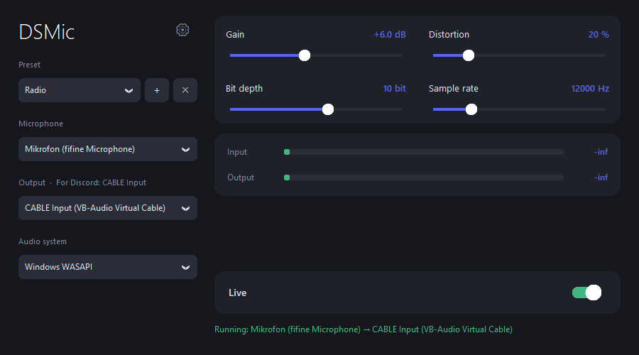

# DSMic

**English** · [Deutsch](README.de.md)

A small Windows app that takes your microphone, processes it live (gain, distortion, lo-fi "quality"), and sends the result to a virtual audio cable, so people on **Discord** (or any other app) hear your processed voice.



## Features

- **Gain**: -20 to +40 dB
- **Distortion**: 0-100 % soft-clip overdrive
- **Quality**: bit depth (2-16 bit) and sample rate (2 000-48 000 Hz) reduction for radio, phone or retro sounds
- **Presets**: built-in (Normal, Loud, Radio, Phone, Robot, Megaphone, Retro 8-bit, Chaos) plus your own
- **Live level meters** for input and output, even before audio is routed
- **Always live**: audio starts as soon as the app opens; a *Live* switch pauses it
- **Start with Windows**, optionally minimized
- **Languages**: English, Deutsch, Magyar
- **Installer** that can download and install the VB-CABLE virtual audio cable for you

## How it works

```
Microphone ──► DSMic (gain → distortion → bit/sample-rate crush) ──► CABLE Input
                                                                         |
                                          Discord input device ◄── CABLE Output
```

DSMic itself does not create a virtual device. It writes to one. [VB-CABLE](https://vb-audio.com/Cable/) provides that device.

## Installation

### Option A: installer (recommended)

1. Run `DSMic_Setup.exe` (administrator rights are required).
2. Keep **"Download and install the VB-CABLE virtual audio cable"** ticked if you don't have it yet. The installer downloads it from the official vb-audio.com site. The option is hidden if VB-CABLE is already installed.
3. Windows may ask you to confirm the VB-Audio driver. Restart Windows if the cable doesn't show up.

### Option B: run from source

Requires Windows and Python 3.10+.

```bash
pip install sounddevice numpy customtkinter
python main.py
```

Install VB-CABLE manually from <https://vb-audio.com/Cable/>.

## Using it with Discord

1. In DSMic, choose your microphone and set **Output** to **CABLE Input (VB-Audio Virtual Cable)**. This is selected automatically when it's available.
2. In Discord open *User Settings → Voice & Video* and set **Input Device** to **CABLE Output (VB-Audio Virtual Cable)**.
3. Turn off Discord's **Automatic input sensitivity** and noise suppression if they affect your effect (they can clean up distortion).
4. Talk and watch the meters. Adjust the sliders or pick a preset while you speak.

> **Don't** set DSMic's output to your speakers or headphones unless you want to hear yourself. A microphone next to speakers will cause feedback.

## Controls

| Control | What it does |
|---|---|
| **Preset** | Loads a set of slider values. **＋** saves the current values as your own preset, **✕** deletes a custom one. |
| **Gain** | Volume boost or cut in dB. |
| **Distortion** | Blend of the clean signal with a hard-driven soft-clipped copy. |
| **Bit depth** | Lower values give a grainier, more "digital" sound. |
| **Sample rate** | Lower values give a muffled, telephone or radio sound. |
| **Live** | Pauses and resumes sending audio. Meters keep working while paused. |
| **⚙ Settings** | Language, start with Windows, start minimized. |

Settings are saved automatically: `%APPDATA%\DSMic\settings.json` for the installed app, or next to `main.py` when running from source.

## Building

Build the executable and the installer:

```bash
pip install pyinstaller
python -m PyInstaller --noconfirm --onefile --noconsole --name DSMic \
  --collect-all customtkinter --collect-all sounddevice --collect-all _sounddevice_data main.py
copy dist\DSMic.exe .
```

Then compile `installer.iss` with [Inno Setup 6](https://jrsoftware.org/isinfo.php) (`ISCC.exe installer.iss`) to get `DSMic_Setup.exe`.

## Troubleshooting

- **Input meter shows `-inf`**: that means no signal at all. Check that the right microphone is selected, that it isn't muted, and that *Settings → Privacy → Microphone → Let desktop apps access your microphone* is on. Try switching **Audio system** to MME.
- **No `CABLE Input` in the Output list**: VB-CABLE isn't installed, or Windows needs a restart after installing it.
- **Others hear nothing in Discord**: make sure Discord's input device is **CABLE Output**, and that the **Live** switch is on.
- **Audio delay or crackling**: prefer the **Windows WASAPI** audio system. Close other programs that use the microphone exclusively.

## Notes

- Windows only.
- VB-CABLE is a separate product by VB-Audio and is **not** bundled with DSMic. The installer downloads it from the official site, and it is donationware. Please see vb-audio.com for its license.
